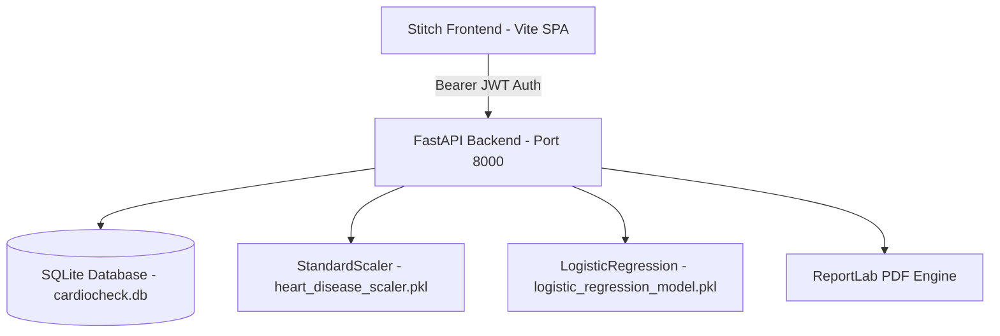

# CardioCheck — Heart Disease Clinical Decision Support System

An end-to-end clinical decision support platform combining an authentic Google Stitch medical UI with a Python FastAPI backend powered by a machine-learning model trained on the Cleveland Heart Disease dataset.

[](https://render.com/deploy?repo=https://github.com/aryanhavkar23/CardioCheck)

---

## System Architecture



### Components:
1. **Frontend (`/Frontend`)**:
   - Single Page Application built on modern Vite + Vanilla JS, preserving 100% of the Google Stitch exported interface.
   - 4 full clinical workflows: **Doctor Dashboard**, **13-Feature Clinical Assessment Form**, **Classification Results**, and **Patient Profile & Assessment History**.
   - Modular modals for Physician Authentication and Patient Registration/Editing.
2. **Backend (`/Backend`)**:
   - Asynchronous Python 3.14+ FastAPI backend.
   - Scikit-Learn `StandardScaler` (13 features) + `LogisticRegression` binary classifier (`Class 0: No Heart Disease Category`, `Class 1: Heart Disease Category Present`).
   - Automated mapping layer reconciling frontend options with canonical Cleveland training codes (`cp` 1–4, `slope` 1–3, `thal` 3, 6, 7).
   - Strict physician data isolation, immutable assessment snapshots, and dynamic ReportLab PDF clinical report generation.
   - Comprehensive test suite with **20 passing tests**.

---

## Quickstart Guide (Windows PowerShell)

### Step 1: Start the Backend Server

```powershell
# Open terminal 1
cd "d:\workspace\Heart dieases\Backend"
python -m pip install -r requirements.txt
python -m app.seed
python -m uvicorn app.main:app --reload --host 127.0.0.1 --port 8000
```
- API Health Check: [http://127.0.0.1:8000/api/health](http://127.0.0.1:8000/api/health)
- Interactive OpenAPI Docs: [http://127.0.0.1:8000/docs](http://127.0.0.1:8000/docs)

### Step 2: Start the Frontend Application

```powershell
# Open terminal 2
cd "d:\workspace\Heart dieases\Frontend"
npm install
npm run dev
```
- Open your browser to: [http://localhost:5173](http://localhost:5173)

### Step 3: Login as the Demo Physician

- Click **"One-Click Sign In (Dr. Sarah Jenkins)"** or enter:
  - **Email**: `doctor@cardiocheck.io`
  - **Password**: `CardioCheck2026!`

---

## Verifying the Test Suite

```powershell
cd "d:\workspace\Heart dieases\Backend"
python -m pytest -v
```
Output:
```
====================== 20 passed in ~38s ======================
```

---

## Cloud Deployment (Render Blueprint)

CardioCheck includes a validated `render.yaml` blueprint that provisions:
1. **PostgreSQL Database** (`cardiocheck-db`): Persistent managed database with auto-generated credentials.
2. **FastAPI Web Service** (`cardiocheck-backend`): Python 3.11 service with auto-wired PostgreSQL connection string, dynamic JWT secret, and ML model inference.
3. **Static Site** (`cardiocheck-frontend`): High-speed Vite SPA deployed on Render's global CDN with client-side routing rewrites.

### 1-Click Deployment
Click the badge at the top or visit:
**[Deploy CardioCheck on Render](https://render.com/deploy?repo=https://github.com/aryanhavkar23/CardioCheck)**

